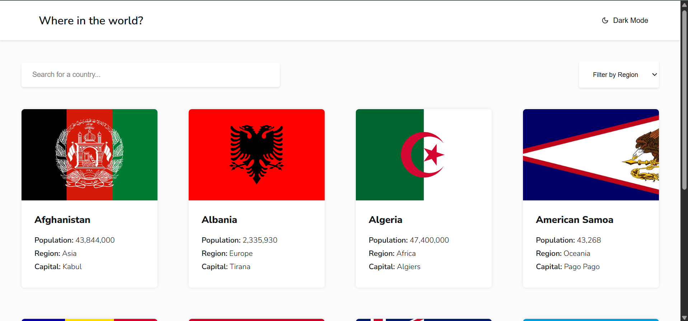
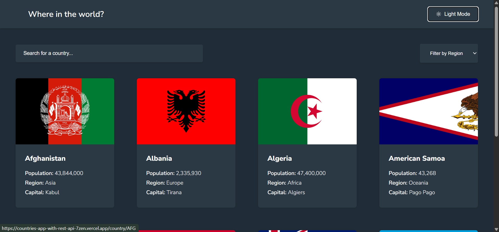

# REST Countries API with color theme switcher

This is my solution to the [REST Countries API with color theme switcher challenge on Frontend Mentor](https://www.frontendmentor.io/challenges/rest-countries-api-with-color-theme-switcher-5cacc469fec04111f7b848ca). I built it to practise my coding and problem solving.

## Table of contents

- [Overview](#overview)
  - [The challenge](#the-challenge)
  - [Screenshot](#screenshot)
  - [Links](#links)
- [My process](#my-process)
  - [Built with](#built-with)
  - [What I learned](#what-i-learned)
  - [Continued development](#continued-development)
  - [Useful resources](#useful-resources)
  - [AI Collaboration](#ai-collaboration)
- [Author](#author)
- [Acknowledgments](#acknowledgments)

## Overview
An interactive web app that gives a brief description of the all the 250 countries live in the 'data.json' using REST API with a colour theme switcher.

### The challenge

Users should be able to:

- See countries from the API on the homepage
- Search for a country using th searchbar
- Filter countries by region
- Click on a country to see more detailed information on a separate page
- View the border countries on the detail page
- Toggle the color scheme between light and dark mode

### Screenshot

Light mode:



Dark mode:



### Links

- Solution URL: [https://github.com/lois-narh/Countries-App-with-REST-API]
- Live Site URL: [https://countries-app-with-rest-api-7zen.vercel.app]

## My process

### Built with

- React
- TypeScript
- Semantic HTML5 markup
- CSS custom properties
- Vite
- React Router
- A small Node script - to download the country data and save it as a JSON file
- [React Icons](https://react-icons.github.io/react-icons/) - for the moon, sun and arrow icons
- [REST Countries API](https://restcountries.com/docs/countries) (v5) - for the country data
- [Vercel](https://vercel.com) - for deployment

### What I learned

**Getting data from an API.** I use the REST Countries API for all the data. At first I fetched it in the browser with `useEffect`, saved it in state and used `map` to show a card for each country. Later I moved the fetching into a small script, `save-countries.mjs`, that downloads all the countries once and saves them in `src/data/countries.json`. The app now reads that file, so the countries show up straight away. I also learned to read the error message in the console, because that is what showed me when the API address or my key was wrong.

**Routing.** Each card links to `/country/CODE`. The details page reads the code with `useParams` and finds that country in the list that is already loaded, so it doesn't need another request. The border countries work the same way.

**CSS order matters.** My mobile styles did nothing until I moved the media queries to the bottom of the file. When two rules match, the one that comes later wins.

**API keys and deployment.** At first I called the API from the browser and kept my key in a `VITE_` variable. A reviewer showed me that Vite copies those variables into the built JavaScript, so anyone could read my key on the live site. I replaced that key, took the API call out of the app, and now the key only lives in a `.env` file on my computer that is not pushed to GitHub. The script uses it to download the data. If I want to refresh the countries, I run:

```bash
node --env-file=.env save-countries.mjs
```

and then commit the new `countries.json`.

### Continued development
Here are somethings i think i would implement afterwards:

- Remember the dark mode choice when the page is refreshed
- Move the API call to a small server function so the key is not visible in the browser
- Improve accessibility, like keyboard use and focus styles

### Useful resources

- [REST Countries docs](https://restcountries.com/docs/countries) - I used this to find the fields and to see how the new v5 API works.
- [React Router docs](https://reactrouter.com) - This helped me understand routes and `useParams`.

### AI Collaboration

AI was of good assistancse(Claude AI). It explained things I was finding hard to understand and also with the API.

## Author

- GitHub - [@lois-narh](https://github.com/lois-narh)

## Acknowledgments

Thanks to Frontend Mentor for the challenge, the designs and the style guide, and to REST Countries for the API.
